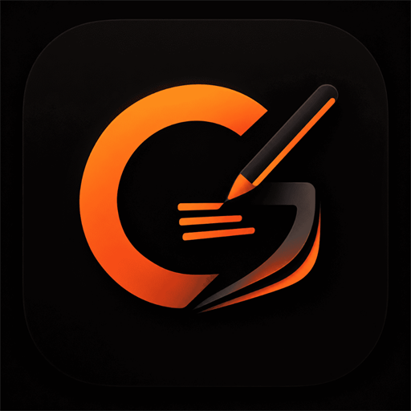

<div align="center">
  
  <h1>Graphite — The Best Note-Taking and E-Book Reader Open-Source App</h1>
  <p><strong>A fluid, privacy-first digital notebook, stylus precision handwriting, and powerful PDF / E-Book reader for Android.</strong></p>

  <p>
    <a href="https://github.com/ayushmanchakraborty254-create/Graphite/releases/latest"></a>
    
    
    
    
  </p>
</div>

---

## ⚡ What is Graphite?

**Graphite** is an all-in-one open-source **digital note-taking and e-book reading workstation** engineered specifically for Android tablets, foldables, and smartphones. Designed for students, academics, researchers, and book lovers, Graphite bridges the gap between hardware stylus writing, distraction-free book reading, and effortless cross-device cloud synchronization.

Whether you're reading a 500-page textbook, highlighting academic papers, annotating lecture slides, jotting down math formulas with your stylus, or dictating ideas with AI voice-to-text, Graphite delivers a desktop-class experience with zero latency.

---

## ✨ Key Features

### 📚 1. Advanced E-Book & PDF Reader
* **Distraction-Free Bookshelf**: Organize your personal library of PDFs, textbooks, research papers, and documents in an elegant virtual bookshelf.
* **Smart Reading Modes**: Day, Sepia, and Night reading themes tailored to prevent eye strain during late-night study sessions.
* **Interactive Document Markup**: Highlight text, bookmark important chapters, view instant page thumbnails, and jump to specific sections.
* **Office & Document Import**: Native support for importing and reading **PDF, DOCX, and PPTX** files without breaking original formatting.

### 🔄 2. Seamless Real-Time Cross-Device Sync & Backup
* **Instant Cloud Sync**: Powered by Supabase, your notebooks, page markings, and book progress synchronize in real time across all your Android tablets and phones.
* **Offline-First Architecture**: Work completely offline with zero lag. When your device reconnects to Wi-Fi or cellular data, all changes automatically merge in the background.
* **Google Drive Cloud Backups**: One-tap export and backup of your notebooks and annotated PDFs directly to your Google Drive (`drive.file`).
* **Canonical Proportional Scaling**: Vector and canonical dimension scaling ensure that notes written on a 14-inch tablet look proportionally identical on a 6-inch phone.

### ✍️ 3. Ultra-Low-Latency Inking & Stylus Precision
* **Hardware Stylus & S-Pen Precision**: Sub-millisecond stroke latency with natural pressure sensitivity, tilt control, and active palm rejection.
* **Versatile Inking Tools**: Ballpoint Pen, Fountain Pen, Highlighter with adjustable opacity, Stroke Eraser, and Precision Pixel Eraser.
* **Lasso Selection & Transformation**: Circle handwritten strokes or drawings to translate, resize, or delete them across the page.

### 🎙️ 4. Voice-to-Text & AI Speech Dictation
* **Continuous Fast Speech Recognition**: On-device speech recognition tuned for rapid dictation without dropped syllables.
* **Cloud AI Transcription**: Transcribe long voice notes and classroom lectures using Google Gemini 2.5 Flash and Whisper AI.
* **Automatic Sentence Capitalization**: Clean formatting with smart sentence-boundary capitalization.

### 🔤 5. Dynamic Rich Text Boxes
* **Freely Movable & Resizable**: Tap anywhere to drop a text box. Fluidly resize width and reposition across the page with zero-latency grab handles.
* **Rich Typography**: Custom font families (Default Sans, Serif, Monospace, Cursive), font sizes, bold, italic, underline, and color swatches.

### 🎨 6. Curated Notebook Covers & Paper Templates
* **Custom Paper Styles**: Ruled, Grid, Dotted, and Blank paper templates that scale dynamically with zoom.
* **60+ Curated Cover Designs**: Unsplash photography, minimalist art, and abstract patterns.
* **Gallery Image Auto-Fit**: Import any photo from your camera or gallery with automatic center-cropping to standard 3:4 notebook cover proportions.

---

## 📥 Download and Install

Download the latest release APK directly to your Android device:

👉 **[Download Latest Graphite APK](https://github.com/ayushmanchakraborty254-create/Graphite/releases/latest/download/Graphite-v1.0.0.apk)**

1. Tap the download link above on your Android tablet or phone.
2. Open the downloaded `.apk` file from your notification bar or file manager.
3. Allow "Install unknown apps" if prompted, and start using Graphite!

---

## 🛠️ Building from Source

To compile and run Graphite locally:

```bash
# 1. Clone the repository
git clone https://github.com/ayushmanchakraborty254-create/Graphite.git
cd Graphite

# 2. Build the debug APK
./gradlew assembleDebug

# 3. Install directly to a connected Android tablet or phone
./gradlew installDebug
```

---

## 🛡️ Privacy & Security

Graphite operates on a strict **privacy-first, local-first** principle:
* All notes, handwriting, audio recordings, and documents are stored locally on your device.
* Cloud sync and Google Drive integrations are completely optional and use minimal sandboxed scopes (`drive.file`).
* For complete details, see our [Privacy Policy](PRIVACY.md).

---

## 📄 License

Graphite is proudly released under the **[MIT License](LICENSE)**. Contributions, pull requests, and feedback are always welcome!
